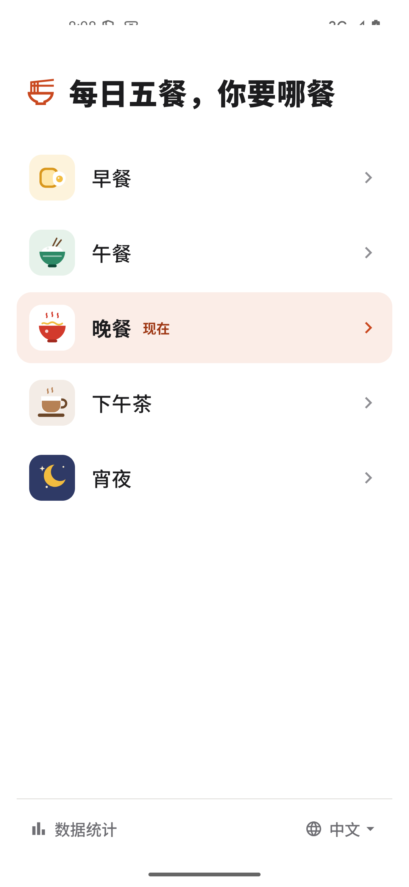
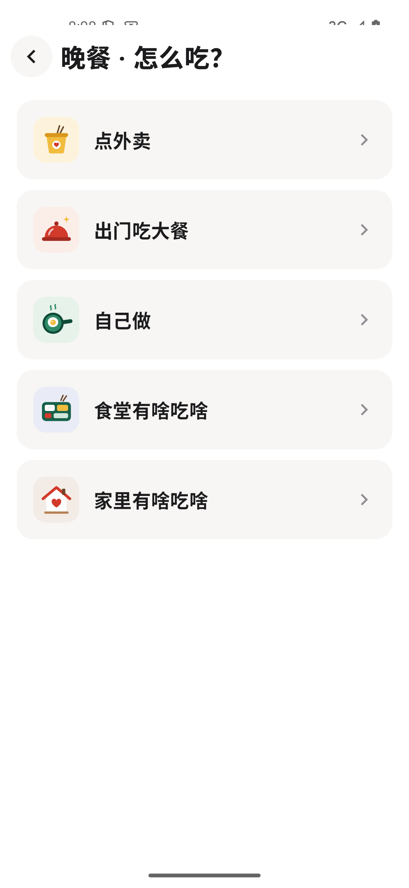

# 吃什么

一个帮你决定这一餐吃什么的安卓 App。把常吃的店、菜和食材留在手机里，用转盘和餐馆卡牌做选择，也可以整理采购与做饭清单。

**v1.4.5 是本项目的首次公开发布版。** 支持 Android 8.0 及以上，离线使用，采用 MIT 开源协议。

[下载最新版 APK](https://github.com/Jayzengcodetrip/chishenme/releases/latest) · [查看 v1.4.5 发布说明](https://github.com/Jayzengcodetrip/chishenme/releases/tag/v1.4.5) · [反馈问题](https://github.com/Jayzengcodetrip/chishenme/issues)

<p>
  
  
</p>

## 可以做什么

- **五餐各有自己的数据。** 早餐、午餐、晚餐、下午茶、宵夜分别保存分类、店名、菜名、备注、顺序、次数、购物车和烹饪菜单。改早餐，不会改到午餐。
- **转盘帮忙选。** 点外卖包含营养控制区和心情口味区。所有扇区等分、等概率，只有指针转动；停下后由你决定点进哪一项。转盘分类和里面的条目都能编辑。
- **餐馆可以挑，也可以抽。** “全国连锁”用餐馆卡牌展示店名、备注和次数；点“抽一家”洗牌，再亲手翻一张。洗牌不会改动已保存的顺序，也不会增加次数。
- **自己做饭有两份清单。** 食材可分别加入购物车和烹饪菜单，再点一次即可取消。购物车区分待采购和已采购，已采购食材可单项或批量转入菜单；菜单全部勾选完成后，点“本餐完成”才记录这次做饭并清空菜单。
- **记录和整理常吃的东西。** Pick 增加一次记录；支持新增、改名、编辑备注、拖动排序、删除和手动修改次数。餐馆备注直接可见，也可点开编辑弹窗。
- **按餐查看统计。** 查看各类总次数和具体条目次数；同名食物在不同位置独立记录。删除条目也会删除对应统计，删除分类会同时删除其中的条目。
- **中文和 English 界面。** 语言选择位于首页底部，只切换产品文案；自定义店名、菜名、备注和分类名保持原文，Pick 保持原样。

宵夜的“点外卖”直接打开吃的／喝的清单；“食堂有啥吃啥”和“家里有啥吃啥”提供可以换一条的简短语录。应用提供选择参考，不接入外卖平台，不替你下单，也不计算营养摄入。

## 安装与数据

1. 打开 [Releases](https://github.com/Jayzengcodetrip/chishenme/releases/latest)，在附件中下载 `.apk` 文件。
2. 在安卓手机上打开 APK，按系统提示允许该来源安装应用。
3. 已安装本项目正式版时，直接更新即可。**不要为更新而先卸载**，卸载或清除应用数据会删除手机上的记录。

正式版包名为 `com.mealpick.app`。本次 v1.4.5 发布沿用此前正式安装包的签名，可覆盖更新既有版本。GitHub 自动提供的源码 ZIP 不是安装包。

首次打开会为每餐分别建立同样的初始内容，此后五餐独立变化：

| 初始内容 | 每餐数量 |
|---|---:|
| 心情口味区餐品 | 34 条，9 个分类 |
| 大餐商家 | 12 条，2 个分类 |
| 零食与饮品 | 15 条，2 个分类 |
| 做饭食材 | 6 条，分在主食、蛋白质、蔬菜 3 类中 |
| 营养控制区转盘选项 | 5 个，内部餐品列表初始为空 |

其中餐品、商家、零食与饮品合计 **61 条**，另有 **6 条食材**和 **5 个营养区选项**。预置内容都能按自己的习惯修改。种子数据已包含在源码中，构建和使用不需要原始 Word 文档。

数据只在首次初始化时导入；重启、普通覆盖升级、删除条目或删空清单不会重新填回。升级通过数据库迁移保留已有数据，不用预置内容覆盖你的修改。

应用无账号、云同步和联网请求，数据保存在安装设备本地。目前没有应用内导出或备份功能，Android 自动备份也已关闭。

## 本地构建

使用 Kotlin、Jetpack Compose 和 Room，构建环境如下：

| 项目 | 版本 |
|---|---|
| JDK／Java 字节码目标 | 17 |
| Android SDK | compileSdk 35，targetSdk 35，minSdk 26 |
| Android Gradle Plugin | 8.9.2 |
| Gradle Wrapper | 8.11.1 |
| Kotlin／Compose 编译插件 | 2.1.20 |
| KSP | 2.1.20-1.0.32 |
| Compose BOM | 2025.04.01 |
| Room | 2.7.1，数据库 schema 版本 4 |

安装 JDK 17、Android SDK Platform 35 和 Build Tools 35.0.0，然后克隆仓库：

```sh
git clone https://github.com/Jayzengcodetrip/chishenme.git
cd chishenme
./gradlew :app:assembleDebug
```

也可以用 Android Studio 打开仓库根目录，选择兼容的 Gradle JDK 后同步项目。SDK 路径使用本机的 `ANDROID_HOME`，或由 Android Studio 生成 `local.properties`。首次同步需要下载 Gradle 和依赖；`local.properties` 不应提交。

调试 APK 位于 `app/build/outputs/apk/debug/app-debug.apk`。连接模拟器或开启 USB 调试的手机后，可执行：

```sh
./gradlew :app:installDebug
```

调试版包名为 `com.mealpick.app.debug`，可与正式版同时安装，数据彼此独立。**调试签名不等于正式签名，调试版不能覆盖正式版。** 自行签署的 release 包也不能覆盖签名不同的正式版。

仓库不包含正式签名私钥或密码。无私有签名配置时，`./gradlew :app:assembleRelease` 生成未签名的 release 包；希望直接安装正式版，请使用 Releases 中的 APK。Fork 后自行发布时，请使用自己的应用标识和签名。

## 测试与验证范围

```sh
# 本地单元测试
./gradlew :app:testDebugUnitTest

# Android 设备测试：先启动模拟器或连接测试手机
./gradlew :app:connectedDebugAndroidTest
```

设备测试会重置调试应用的测试数据，请使用专用测试设备或模拟器。

v1.4.5 在 **2026-10-17** 完成的发布前验证：

- **17 项单元测试通过，83 项 Android 设备测试通过**，设备测试 0 失败、0 跳过。
- 环境为 Android 15／API 35／arm64 模拟器，系统动画开启，分辨率 1080 × 2340，字体比例 1.0。
- 覆盖五餐隔离、计数、编辑与删除、数据迁移、转盘、餐馆抽牌、购物车、烹饪菜单以及首页往返动画。
- 实际执行正式版 1.4.4 → 1.4.5 覆盖安装，并核对升级前后的本地数据库、签名、图标和种子内容。

这是该版本的既有验证记录，不表示所有手机型号都经过测试；本轮发布前验证未连接实体手机。v1.4.5 的界面调整主要修复首页与吃法页往返时的布局跳动，使用约 160 毫秒的原位淡入淡出。

## 源码地图

```text
app/src/main/
├── assets/seed.json                  # 首次安装的餐品与分类
├── java/com/mealpick/app/
│   ├── MainActivity.kt              # Android 入口
│   ├── data/
│   │   ├── MealDatabase.kt          # Room、查询与数据库迁移
│   │   ├── MealModels.kt            # 数据模型
│   │   ├── MealRepository.kt        # 初始化、五餐隔离、计数与清单事务
│   │   └── MealViewModel.kt         # 页面状态与操作入口
│   └── ui/
│       ├── MealApp.kt               # 导航、通用列表、编辑与统计
│       ├── FlowScreens.kt          # 首页、吃法页与语录
│       ├── WheelSection.kt         # 转盘
│       ├── Dining*.kt              # 餐馆卡牌与抽牌
│       ├── CookingScreens.kt       # 自己做、购物车与烹饪菜单
│       ├── MealTheme.kt / Motion.kt # 视觉与动效参数
│       └── Strings.kt              # 中英文产品文案
└── res/                             # 应用图标与 Android 资源
app/src/test/                        # 本地单元测试
app/src/androidTest/                 # 数据与界面集成测试
app/schemas/                         # Room 历史 schema
design-system/chishenme/             # 页面、配色与动效规范
docs/meal-isolation.md               # 五餐隔离与迁移说明
```

做饭的初始食材定义在 `MealRepository.kt` 中。`tools/verify_seed.py` 是维护者用于与原始资料比对的可选工具，不属于构建或测试的必需步骤。

## 贡献

欢迎通过 [Issue](https://github.com/Jayzengcodetrip/chishenme/issues) 提交问题或讨论改进，再通过 Pull Request 提交修改。报告界面问题时，请附上应用版本、Android 版本、复现步骤和不含私人数据的截图。

修改时请保留五餐隔离和已有数据，数据库结构变更需要提供显式迁移；不要用清空数据库来绕过升级问题。产品文案同时维护中文和英文，自定义内容不自动翻译。涉及数据或交互的改动，请运行对应测试，并说明实际验证设备与尚未验证的部分。

签名文件、密码、设备数据库、私人截图、本机路径与构建缓存不要提交到仓库。

## 开源协议

项目源码采用 [MIT License](LICENSE)。主要第三方组件包括 Kotlin、AndroidX／Jetpack Compose、Material Components、Room、Kotlin Coroutines、Gradle 和测试工具；它们各自的许可与项目链接见 [第三方说明](THIRD_PARTY_NOTICES.md)。本项目的 MIT 许可不改变这些组件原有的许可条款。
